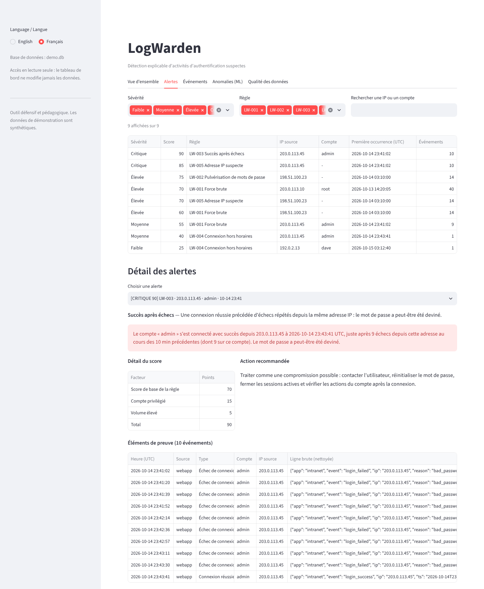

# LogWarden

*English version: [README.md](README.md)*

**Détection locale et explicable d'activités d'authentification suspectes dans des journaux
Linux/SSH et d'application web.** LogWarden importe des journaux, les convertit dans un format
d'événement commun, applique cinq règles de détection transparentes, attribue à chaque alerte un
score de 0 à 100, l'explique en français ou en anglais, stocke le tout dans SQLite et produit un
rapport ainsi qu'un tableau de bord local. Une Isolation Forest optionnelle signale les attaques
lentes qui restent sous les seuils des règles.

> Projet défensif et pédagogique, réalisé pour un portfolio d'étudiant. Toutes les données de démonstration sont synthétiques.



## Fonctionnalités

| Étape | Détail |
|---|---|
| **Importer** | messages OpenSSH d'`auth.log` (horodatages classiques et RFC 3339) et journal JSON Lines d'une application web. Les lignes invalides sont comptées avec leur motif, jamais ignorées en silence ; les doublons sont écartés ; les secrets (`password`, `token`…) sont masqués. |
| **Détecter** | LW-001 force brute · LW-002 pulvérisation de mots de passe · LW-003 succès après échecs · LW-004 connexion hors horaires · LW-005 IP suspecte (corrélation) |
| **Évaluer le risque** | score additif et explicable : base de la règle + compte privilégié + connexion réussie + volume → faible / moyenne / élevée / critique |
| **Expliquer** | chaque alerte donne les événements de preuve, une phrase, le détail du score et une action recommandée, en FR ou EN |
| **Stocker** | SQLite : événements, alertes, liens alerte↔événements, qualité d'importation, scores ML |
| **Rapporter** | rapport Markdown + graphiques PNG + export CSV/JSON, dans les deux langues |
| **Explorer** | tableau de bord Streamlit bilingue, en lecture seule, limité à 127.0.0.1 |
| **Anomalies** | Isolation Forest optionnelle par (IP, heure), comparée honnêtement aux règles |

## Récupérer le projet depuis l'archive Git (Windows 11 + WSL)

1. Télécharge `logwarden.bundle` (par exemple dans `C:\Users\<toi>\Downloads`).
2. Ouvre le terminal **Ubuntu (WSL)** et lance :

```bash
sudo apt update && sudo apt install -y python3-venv python3-pip git make   # une seule fois
mkdir -p ~/projects
git clone /mnt/c/Users/<toi>/Downloads/logwarden.bundle ~/projects/logwarden
cd ~/projects/logwarden
git log --oneline | head     # vérifie l'historique
git remote remove origin     # l'archive n'est pas un dépôt distant : on la détache
```

`/mnt/c/...` est la façon dont WSL voit le disque `C:` de Windows. Remplace `<toi>` par ton nom
d'utilisateur Windows. Travaille ensuite dans `~/projects/logwarden` (système de fichiers Linux,
bien plus rapide que `/mnt/c`).

## Installation et lancement (Python ≥ 3.11)

```bash
cd ~/projects/logwarden
python3 -m venv .venv            # environnement virtuel isolé
source .venv/bin/activate        # à refaire à chaque nouveau terminal
pip install --upgrade pip
pip install -e ".[all]"          # cœur + ML + tableau de bord + outils de test

logwarden demo --lang fr         # génère les données, importe, détecte, ML, rapports (FR + EN)
logwarden dashboard --lang fr    # ouvre http://127.0.0.1:8501 dans le navigateur Windows
pytest                           # 379 tests
```

WSL2 relaie automatiquement `localhost` vers Windows : ouvre simplement
`http://127.0.0.1:8501` dans Edge ou Chrome. `Ctrl+C` dans le terminal arrête le tableau de bord.
Le rapport est dans `reports/demo/report.fr.md` (ouvrable dans VS Code avec l'aperçu Markdown).

Versions exactes testées : `pip install -r requirements-lock.txt && pip install -e . --no-deps`.
Le `Makefile` propose les mêmes commandes (`make install`, `make demo`, `make test`, `make dashboard`).

## Utilisation sur tes propres fichiers

```bash
logwarden ingest /chemin/auth.log app.jsonl --year 2026 --tz Europe/Paris
logwarden detect
logwarden anomalies --baseline semaine_normale/auth.log   # optionnel, nécessite [ml]
logwarden report --out reports/latest --lang fr
logwarden alerts --min-severity high --lang fr
logwarden dashboard
```

Options globales : `--lang en|fr` (ou `LOGWARDEN_LANG`), `--db fichier.db` (ou `LOGWARDEN_DB`,
par défaut `logwarden.db`), `--config mon.toml` (remplace n'importe quelle valeur de
[`default_config.toml`](src/logwarden/default_config.toml)). `logwarden <commande> -h` pour l'aide.

## Résultats de la démonstration (réellement produits par `logwarden demo`)

Jeu synthétique : 5 jours ouvrés, 865 lignes → 334 événements, 4 lignes mal formées, 1 doublon,
5 scénarios d'attaque étiquetés ([data/README.md](data/README.md)).

| # | Sévérité | Score | Règle | IP | Compte |
|---|---|---|---|---|---|
| 1 | CRITIQUE | 90 | LW-003 Succès après échecs | 203.0.113.45 | admin |
| 2 | CRITIQUE | 85 | LW-005 Adresse IP suspecte | 203.0.113.45 | – |
| 3 | ÉLEVÉE | 75 | LW-002 Pulvérisation de mots de passe | 198.51.100.23 | – |
| 4 | ÉLEVÉE | 70 | LW-001 Force brute | 203.0.113.10 | root |
| 5 | ÉLEVÉE | 70 | LW-005 Adresse IP suspecte | 198.51.100.23 | – |
| 6 | ÉLEVÉE | 60 | LW-001 Force brute | 198.51.100.23 | – |
| 7 | MOYENNE | 55 | LW-001 Force brute | 203.0.113.45 | admin |
| 8 | MOYENNE | 40 | LW-004 Connexion hors horaires | 203.0.113.45 | admin |
| 9 | FAIBLE | 25 | LW-004 Connexion hors horaires | 192.0.2.13 | dave |

* Les 4 scénarios détectables par règles déclenchent exactement les règles attendues ; **0 alerte**
  sur le trafic normal.
* L'attaque lente (31 échecs en 3 h) ne déclenche **aucune règle** ; l'Isolation Forest signale ses
  3 fenêtres. Par fenêtre : règles précision 100 % / rappel 57 %, ML 86 % / 86 %, combinés 88 % / 100 %.
* ⚠️ Ces chiffres montrent seulement que LogWarden retrouve des attaques injectées dans des données
  générées pour cela. Ce sont des tests de non-régression, **pas** une performance réelle. Voir
  [docs/fr/ml.md](docs/fr/ml.md).

## Qualité

* **379 tests automatisés** (pytest) : parseurs et entrées mal formées, fichiers vides / binaires /
  trop gros, horodatages invalides, changement d'année, doublons, chaque règle (cas positif,
  négatif, limite), bornes de sévérité, validation de la configuration, erreurs SQLite (base
  corrompue, lecture seule, annulation de transaction), complétude des traductions, injections
  CSV/Markdown, déterminisme du ML, démo de bout en bout, codes de sortie de la CLI, et tableau de
  bord exécuté sans navigateur avec `AppTest` de Streamlit dans les deux langues.
* Vérifié sous Python 3.11, 3.12 et 3.13 depuis un clone propre ; `ruff` sans erreur.
* Intégration continue GitHub Actions prête (`.github/workflows/ci.yml`), active dès la publication.

## Documentation

* [Architecture et décisions](docs/fr/architecture.md)
* [Règles de détection](docs/fr/detection-rules.md)
* [Détection d'anomalies : méthode, résultats, limites](docs/fr/ml.md)
* [Sécurité, limites et améliorations](docs/fr/securite-et-limites.md)
* [Préparation portfolio et entretiens](docs/fr/portfolio.md)
* [Données synthétiques](data/README.md)

## Reprendre le développement

```bash
source .venv/bin/activate
git switch -c feature/ma-fonctionnalite   # une branche par évolution
# ... modifications ...
make lint test                            # ou : ruff check src tests && pytest
git add -p && git commit -m "feat: ..."
```

## Publier plus tard sur ton GitHub

1. Sur github.com : **New repository** → nom `logwarden`, **sans** README ni licence (le projet les contient).
2. Dans WSL :

```bash
cd ~/projects/logwarden
git remote add origin https://github.com/<ton-compte>/logwarden.git
git push -u origin main
```

(GitHub demande un *personal access token* ou une clé SSH comme mot de passe.) Le workflow
`.github/workflows/ci.yml` lancera alors automatiquement lint, tests et démo sous Python 3.11 à 3.13.
Avant de publier, vérifie `git log` : les commits portent ton nom et ton adresse e-mail (modifiable
avec `git config user.email`).

## Licence

MIT. À utiliser uniquement sur des journaux que tu es autorisé à analyser.
