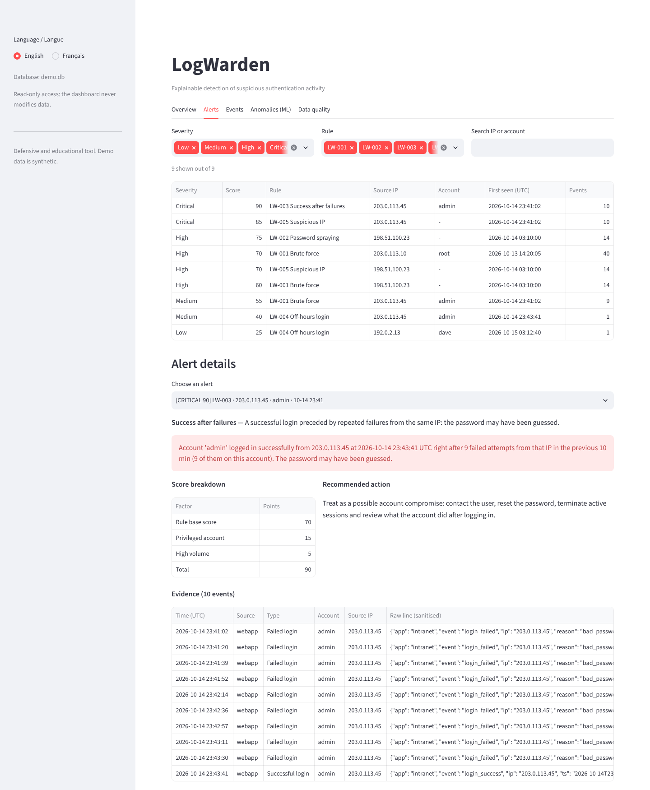

# LogWarden

*Version française : [README.fr.md](README.fr.md)*

**Local, explainable detection of suspicious authentication activity in Linux/SSH and web
application logs.** LogWarden imports logs, normalises them into one event format, runs five
transparent detection rules, scores each alert from 0 to 100, explains it in plain English or
French, stores everything in SQLite and produces a report and a local dashboard. An optional
Isolation Forest flags slow attacks that stay under the rule thresholds.

> Defensive, educational project  All demo data is synthetic.



## Try it

* **Live demo** (no install):  https://logwarden-wilfredsoh.streamlit.app
* **In your browser with GitHub Codespaces**: [](https://codespaces.new/WILFREDSOH/logwarden)
  The environment installs itself and runs the demo; then type `logwarden dashboard` in its terminal.
* **On your machine**: see [Quick start](#quick-start-linux--wsl-python--311) below.

## What it does

| Step | Detail |
|---|---|
| **Ingest** | OpenSSH messages from `auth.log` (classic and RFC 3339 timestamps) and a JSON Lines web-app log. Bad lines are counted with a reason, never silently dropped; duplicates are ignored; secrets (`password`, `token`…) are redacted. |
| **Detect** | LW-001 brute force · LW-002 password spraying · LW-003 success after failures · LW-004 off-hours login ·LW-005 suspicious IP (correlation) · LW-006 distributed attack |
| **Score** | additive and explainable: rule base + privileged account + successful login + volume → low / medium / high / critical |
| **Explain** | each alert lists the evidence events, a sentence, the score breakdown and a recommended action, in EN or FR |
| **Store** | SQLite: events, alerts, links alert↔events, ingestion quality, ML scores |
| **Report** | Markdown report + PNG charts + CSV/JSON export, in both languages |
| **Explore** | Streamlit dashboard, bilingual, read-only, bound to 127.0.0.1 |
| **Anomalies** | optional Isolation Forest per (IP, hour), evaluated honestly against the rules |

## Quick start (Linux / WSL, Python ≥ 3.11)

```bash
sudo apt update && sudo apt install -y python3-venv python3-pip git make   # Ubuntu/WSL, once
cd ~/projects/logwarden
python3 -m venv .venv
source .venv/bin/activate
pip install --upgrade pip
pip install -e ".[all]"          # core + ML + dashboard + test tools

logwarden demo                   # generate data, ingest, detect, ML, reports (EN + FR)
logwarden dashboard              # http://127.0.0.1:8501 (Ctrl+C to stop)
pytest                           # 376 tests
```

For the exact versions that were tested: `pip install -r requirements-lock.txt && pip install -e . --no-deps`.
A `Makefile` wraps the same commands (`make install`, `make demo`, `make test`, `make dashboard`).

## Using it on your own files

```bash
logwarden ingest /path/to/auth.log app.jsonl --year 2026 --tz Europe/Paris
logwarden detect
logwarden anomalies --baseline normal_week/auth.log    # optional, needs [ml]
logwarden report --out reports/latest --lang fr
logwarden alerts --min-severity high
logwarden dashboard
```

Global options: `--lang en|fr` (or `LOGWARDEN_LANG`), `--db file.db` (or `LOGWARDEN_DB`, default
`logwarden.db`), `--config my.toml` (override any value of
[`default_config.toml`](src/logwarden/default_config.toml)). Run `logwarden <command> -h` for details.

## Demo results (actually produced by `logwarden demo`)

Synthetic dataset: 5 working days, 865 log lines → 334 events, 4 malformed lines, 1 duplicate,
5 labelled attack scenarios ([data/README.md](data/README.md)).

| # | Severity | Score | Rule | IP | Account |
|---|---|---|---|---|---|
| 1 | CRITICAL | 90 | LW-003 Success after failures | 203.0.113.45 | admin |
| 2 | CRITICAL | 85 | LW-005 Suspicious IP | 203.0.113.45 | – |
| 3 | HIGH | 75 | LW-002 Password spraying | 198.51.100.23 | – |
| 4 | HIGH | 70 | LW-001 Brute force | 203.0.113.10 | root |
| 5 | HIGH | 70 | LW-005 Suspicious IP | 198.51.100.23 | – |
| 6 | HIGH | 60 | LW-001 Brute force | 198.51.100.23 | – |
| 7 | MEDIUM | 55 | LW-001 Brute force | 203.0.113.45 | admin |
| 8 | MEDIUM | 40 | LW-004 Off-hours login | 203.0.113.45 | admin |
| 9 | LOW | 25 | LW-004 Off-hours login | 192.0.2.13 | dave |

* All 4 rule-detectable scenarios trigger exactly their expected rules; **0 alert** on normal traffic.
* The low-and-slow attack (31 failures in 3 h) triggers **no rule**; the Isolation Forest flags its
  3 windows. Window-level comparison: rules precision 100 % / recall 57 %, ML 86 % / 86 %,
  combined 88 % / 100 %.
* ⚠️ These numbers only show that LogWarden finds attacks injected into data generated for that
  purpose. They are regression tests, **not** real-world performance. See [docs/ml.md](docs/ml.md).

Example explanation (alert 1):
> Account 'admin' logged in successfully from 203.0.113.45 at 2026-10-14 23:43:41 UTC right after
> 9 failed attempts from that IP in the previous 10 min (9 of them on this account). The password
> may have been guessed. — *Score: Rule base score +70 ; Privileged account +15 ; High volume +5 = 90*

## Quality

* **376 automated tests** (pytest): parsers and malformed input, empty/binary/oversized files,
  bad timestamps, year rollover, duplicates, each rule (positive / negative / boundary cases),
  scoring bands, config validation, SQLite errors (corrupted, read-only, rollback), i18n
  completeness, CSV/Markdown injection, ML determinism, end-to-end demo, CLI exit codes, and the
  dashboard rendered headlessly with Streamlit `AppTest` in both languages.
* Verified on Python 3.11, 3.12 and 3.13 from a fresh clone; `ruff` lint + format clean.
* GitHub Actions workflow ready in `.github/workflows/ci.yml` (runs once the repo is published).

## Project layout

```
src/logwarden/
  ingestion/   ssh.py, webapp.py, common.py     parsing, validation, normalisation
  detection/   base.py, scoring.py, rules/      5 rules + engine
  storage/     SQLite Store
  ml/          Isolation Forest (optional)
  reporting/   stats, charts, Markdown, CSV/JSON
  dashboard/   Streamlit app (optional)
  i18n/        en.json, fr.json
  synth/       synthetic data generator
  cli.py       `logwarden` command
tests/unit, tests/integration
data/samples   versioned synthetic logs + ground truth
docs/          architecture, rules, ML, security & limitations (EN + FR), screenshots
```

## Documentation

* [Architecture and decisions](docs/architecture.md)
* [Detection rules](docs/detection-rules.md)
* [Anomaly detection: method, results, limits](docs/ml.md)
* [Security considerations, limitations, improvements](docs/security-and-limitations.md)
* [Synthetic data](data/README.md)

## Limitations (short)

Two log formats only, batch processing, per-IP rules (distributed attacks are missed), generic
thresholds, evaluation on synthetic data only, single-user local dashboard.
Details: [docs/security-and-limitations.md](docs/security-and-limitations.md).

## Licence

MIT. Use only on logs you are authorised to analyse.
