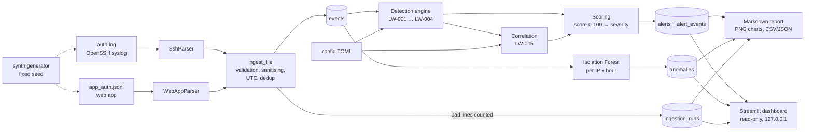

# Architecture and technical decisions

*Version française : [fr/architecture.md](fr/architecture.md)*

## Pipeline

## Package layout

| Module | Responsibility | Depends on |
|---|---|---|
| `models.py` | `Event`, `Alert`, `EventType`, `Severity` (frozen dataclasses) | – |
| `ingestion/` | file checks, `SshParser`, `WebAppParser`, normalisation, dedup | models |
| `detection/` | `Rule` base class, sliding-window `episodes()`, 5 rules, scoring, engine | models |
| `storage/` | `Store`: SQLite schema, idempotent inserts, read-only mode | models |
| `ml/` | feature windows, Isolation Forest scoring (optional extra) | detection (off-hours) |
| `evaluation.py` | compare alerts/anomalies with the synthetic ground truth | synth |
| `reporting/` | statistics, charts, Markdown report, CSV/JSON export | i18n |
| `i18n/` | `t(key, lang, **params)` + `locales/en.json`, `fr.json` | – |
| `dashboard/` | Streamlit app (optional extra) | everything above, read-only |
| `cli.py` | `logwarden` command: `demo`, `ingest`, `detect`, `anomalies`, `report`, `alerts`, `dashboard`, `generate` | everything |

Rules never do I/O: they receive a sorted list of events and return alerts. This is what makes
each rule testable on five hand-written events.

## Data model

* **Event** = one observed fact: `event_id`, UTC `timestamp`, `source` (`ssh`/`webapp`),
  `event_type` (`auth_success`, `auth_failure`, `invalid_user`), `username`, `src_ip`, `host`,
  sanitised `raw` line. `event_id = sha256(source | timestamp | raw)[:20]`: the same line
  ingested twice has the same id, so re-ingestion is a no-op.
* **Alert** = a conclusion: rule, severity, score, period, user, IP, the ids of the events that
  justify it, an explanation **key + parameters**, and the score breakdown.

Storing `explanation_key` + `explanation_params` instead of a sentence is what makes the whole
application bilingual: the same database is rendered in English or French at display time.

## SQLite schema

`events`, `alerts`, `alert_events` (many-to-many link), `ingestion_runs` (data quality per
file), `anomalies` (ML scores), `meta` (schema version). Alerts are *derived data*: each
`detect` run replaces them in a single transaction, so changing a threshold and re-running
gives a consistent result.

## Key decisions

| Decision | Why | Alternative considered |
|---|---|---|
| `src/` layout, installable package with a `logwarden` entry point | tests run against the installed package; standard practice | flat scripts |
| Standard library for parsing/detection (no pandas in the core) | small data, clearer code, fewer dependencies | pandas everywhere |
| SQLite through `sqlite3` (no ORM) | zero setup, transparent SQL, parameterised queries | SQLAlchemy |
| TOML config with strict validation (unknown key = error) | a typo must never silently disable a rule | YAML, env vars |
| Additive score with a stored breakdown | explainable in one sentence to an analyst or a recruiter | weighted formula, ML score |
| One alert per *burst* (episode), not per event | avoids alert floods; matches SOC practice | one alert per window |
| `argparse` CLI | standard library, enough for 8 sub-commands | click, typer |
| Optional extras `[ml]`, `[dashboard]` | the core pipeline only needs matplotlib | everything mandatory |
| Streamlit dashboard, read-only, no upload | quickest useful UI; minimal attack surface | Flask app, upload form |
| Isolation Forest refitted on each run, never pickled | loading pickles can execute code | saving a model file |
| Synthetic data with a separate ground-truth file | reproducible, legal, measurable | public datasets (licences, no labels) |

## Sliding-window episodes

`detection/base.py::episodes(events, window, trigger)` keeps a deque of the events of the last
`window`. When `trigger(deque)` becomes true an episode starts with those events; it absorbs
every following event that arrives less than `window` after the previous one, and closes on a
longer gap. LW-001 uses `len(deque) >= threshold`, LW-002 uses
`len(distinct users) >= distinct_users`. Complexity is O(n) per IP.

## Internationalisation

* `locales/en.json` and `fr.json` contain every user-visible string (CLI, errors, report,
  charts, dashboard, alert explanations, recommendations).
* Language: `--lang`, else `$LOGWARDEN_LANG`, else English. In the dashboard: a sidebar switch.
* Tests check that both files have the same keys, the same `{placeholders}` per key, and that
  every literal key used in the code exists. Adding a third language = adding one JSON file and
  its code to `SUPPORTED_LANGS`.
