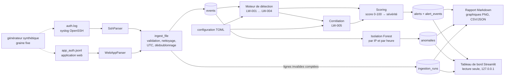

# Architecture et décisions techniques

*English version: [../architecture.md](../architecture.md)*

## Chaîne de traitement

## Organisation du code

| Module | Rôle | Dépend de |
|---|---|---|
| `models.py` | `Event`, `Alert`, `EventType`, `Severity` (dataclasses immuables) | – |
| `ingestion/` | contrôles de fichier, `SshParser`, `WebAppParser`, normalisation, dédoublonnage | models |
| `detection/` | classe `Rule`, fenêtres glissantes `episodes()`, 5 règles, scoring, moteur | models |
| `storage/` | `Store` : schéma SQLite, insertions idempotentes, mode lecture seule | models |
| `ml/` | fenêtres de caractéristiques, Isolation Forest (optionnel) | detection (hors horaires) |
| `evaluation.py` | comparaison alertes/anomalies avec la vérité terrain synthétique | synth |
| `reporting/` | statistiques, graphiques, rapport Markdown, export CSV/JSON | i18n |
| `i18n/` | `t(clé, langue, **paramètres)` + `locales/en.json`, `fr.json` | – |
| `dashboard/` | application Streamlit (optionnelle) | tout ce qui précède, en lecture seule |
| `cli.py` | commande `logwarden` : `demo`, `ingest`, `detect`, `anomalies`, `report`, `alerts`, `dashboard`, `generate` | tout |

Les règles ne font aucune entrée/sortie : elles reçoivent une liste triée d'événements et
renvoient des alertes. C'est ce qui permet de tester chaque règle avec cinq événements écrits à la main.

## Modèle de données

* **Événement** = un fait observé : `event_id`, `timestamp` en UTC, `source` (`ssh`/`webapp`),
  `event_type` (`auth_success`, `auth_failure`, `invalid_user`), `username`, `src_ip`, `host`,
  ligne `raw` nettoyée. `event_id = sha256(source | horodatage | ligne)[:20]` : une même ligne
  importée deux fois a le même identifiant, donc une réimportation ne change rien.
* **Alerte** = une conclusion : règle, sévérité, score, période, compte, IP, identifiants des
  événements qui la justifient, une **clé d'explication + ses paramètres**, et le détail du score.

Stocker `explanation_key` + `explanation_params` plutôt qu'une phrase rend toute l'application
bilingue : la même base est affichée en anglais ou en français au moment de l'affichage.

## Schéma SQLite

`events`, `alerts`, `alert_events` (lien plusieurs-à-plusieurs), `ingestion_runs` (qualité des
données par fichier), `anomalies` (scores ML), `meta` (version du schéma). Les alertes sont des
*données dérivées* : chaque `detect` les remplace dans une seule transaction.

## Décisions principales

| Décision | Justification | Alternative envisagée |
|---|---|---|
| Disposition `src/`, paquet installable avec la commande `logwarden` | les tests portent sur le paquet installé ; pratique standard | scripts isolés |
| Bibliothèque standard pour l'analyse et la détection (pas de pandas dans le cœur) | peu de données, code plus lisible, moins de dépendances | pandas partout |
| SQLite via `sqlite3` (sans ORM) | aucune installation, SQL lisible, requêtes paramétrées | SQLAlchemy |
| Configuration TOML validée strictement (clé inconnue = erreur) | une faute de frappe ne doit jamais désactiver une règle en silence | YAML, variables d'environnement |
| Score additif avec détail stocké | explicable en une phrase à un analyste ou à un recruteur | formule pondérée, score ML |
| Une alerte par *rafale* (épisode), pas par événement | évite l'inondation d'alertes ; conforme aux pratiques SOC | une alerte par fenêtre |
| CLI `argparse` | bibliothèque standard, suffisant pour 8 sous-commandes | click, typer |
| Extras optionnels `[ml]`, `[dashboard]` | la chaîne principale n'a besoin que de matplotlib | tout obligatoire |
| Tableau de bord Streamlit en lecture seule, sans téléversement | interface utile rapidement ; surface d'attaque minimale | Flask, formulaire d'envoi |
| Isolation Forest réentraînée à chaque exécution, jamais sérialisée | charger un pickle peut exécuter du code | fichier de modèle |
| Données synthétiques + fichier de vérité terrain séparé | reproductible, légal, mesurable | jeux publics (licences, pas d'étiquettes) |

## Épisodes à fenêtre glissante

`detection/base.py::episodes(events, window, trigger)` garde une file des événements de la
dernière `window`. Quand `trigger(file)` devient vrai, un épisode démarre avec ces événements ; il
absorbe chaque événement suivant arrivé moins de `window` après le précédent, et se ferme sur un
intervalle plus long. LW-001 utilise `len(file) >= threshold`, LW-002
`nombre de comptes distincts >= distinct_users`. Complexité O(n) par IP.

## Internationalisation

* `locales/en.json` et `fr.json` contiennent tous les textes visibles (CLI, erreurs, rapport,
  graphiques, tableau de bord, explications et recommandations des alertes).
* Langue : `--lang`, sinon `$LOGWARDEN_LANG`, sinon anglais. Dans le tableau de bord : un
  sélecteur dans la barre latérale.
* Des tests vérifient que les deux fichiers ont les mêmes clés, les mêmes `{paramètres}` par clé,
  et que toute clé littérale utilisée dans le code existe. Ajouter une langue = ajouter un fichier
  JSON et son code dans `SUPPORTED_LANGS`.
